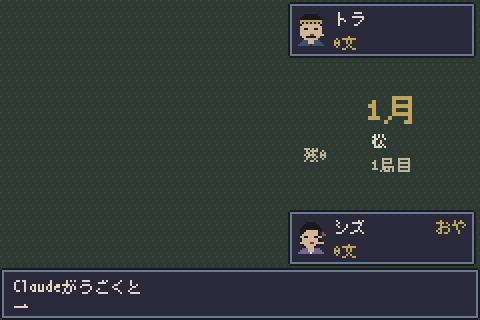

# claude-koikoi



Claude Code がツールを呼ぶたびに、CPU 同士の花札こいこいが一手進む常駐ウインドウ。
GBA 風の 240×160 のドット絵を整数倍で表示する。くすんだ和色で、札48枚はすべてドットで描いている。

- **シズ**(堅実型): 役ができたらすぐあがる
- **トラ**(強欲型): 相手の役が遠ければこいこいする

ツール呼び出しやプロンプト送信のたびに「出す・めくる・こいこいか勝負か」のどれか1ステップが進む。
役ができると「こいこい！」「勝負！」のカットインが入り、12か月で1局。終わると次の局が始まる。
ステータスラインにも `花札 3月 シズ12-7トラ` のように得点が出る。

## しくみ

```
Claude Code (mod: koikoi)  ── ~/.claude/koikoi/ticks/ に空ファイル ──▶  Electron ビューア
  tool.call / prompt.submit                                          src/engine で一手進めて描く
  ステータスラインに得点       ◀── ~/.claude/koikoi/state.json ──
```

対局はビューア側が持っているので、Claude Code を閉じても続きから再開する。
同時に開いている複数のセッションのツール呼び出しも、同じ対局を進める。

## 入れ方

Node.js 22 以降が必要。

### 1. ビューア

```sh
git clone https://github.com/amazake13/claude-koikoi.git
cd claude-koikoi
npm install
node node_modules/electron/install.js   # npm が install script を止める設定のときだけ
npm start
```

一度起動すると `~/.claude/koikoi/launch.json` ができて、以後は mod がセッション開始時にビューアを起動する。

### 2. mod

Claude Code のプロンプトで:

```
/plugin install koikoi --marketplace amazake13/claude-koikoi
```

`Add marketplace?` に `y`、スコープは user を選ぶ。

シェルから入れるときは:

```sh
claude plugin install koikoi --marketplace amazake13/claude-koikoi
```

デスクトップアプリでは `/plugin` が使えないので、プロンプト欄の横の + から Plugins → Add marketplace に `amazake13/claude-koikoi` を入れ、Add plugin で koikoi を選ぶ。

## 操作

| ウインドウのキー | `/koikoi` | |
| --- | --- | --- |
| Space | `pause` | 一時停止の切り替え |
| T | `top` | 最前面表示の切り替え(初期はオフ) |
| N / → | `step` | 一手進める |
| Shift+R | `reset` | 対局をやり直す(通算成績は残る) |
| | `show` | ウインドウを出す(閉じていれば起動する) |

ウインドウはどの大きさでも、ドットがにじまない整数倍で表示する。

## ルール

- 役: 五光10、四光8、雨四光7、三光5、猪鹿蝶5、赤短5、青短5、花見で一杯5、月見で一杯5、
  タネ(5枚で1、以後1枚ごとに+1)、タン(5枚で1)、カス(10枚で1)
- 手四・くっつきは配った時点で6文
- 7文以上は倍、相手がこいこいしていたらさらに倍
- 誰も役ができずに手札がなくなったら流れ

## 開発

```sh
npm test                  # ルールと対局のテスト
npm run sim -- 42         # シード 42 で1局を文字で流す
npm run cards             # 札48枚を cards.png に並べる
KOIKOI_DIR=/tmp/kk KOIKOI_SHOT=/tmp/shot npm start   # 別の置き場所で起動し、一定間隔でスクリーンショット
KOIKOI_SEED=7 ...                                     # 新しい対局のシードを決める (7 は1月にこいこいと猪鹿蝶が出る)
```

| 場所 | 中身 |
| --- | --- |
| `src/engine` | ルールと CPU。UI に依存しない純 TypeScript |
| `src/main` | Electron の main。tick を監視して進め、`~/.claude/koikoi/game.json` に保存する |
| `src/renderer` | 描画。札の絵は `art.ts` に1文字1ドットで描いている |
| `mod` | Claude Code の mod(hooks モジュール) |

札の絵は Wikimedia Commons の [SVG Hanafuda with traditional colors](https://commons.wikimedia.org/wiki/Category:SVG_Hanafuda_with_traditional_colors_(black_border)) を見比べながら、16×24 のドットに描き起こした。

## ライセンス

このリポジトリのコードと絵にはライセンスを付けていない。
同梱の美咲フォント(`assets/misaki_gothic.ttf`)は Num Kadoma 氏の作品で、`assets/misaki.txt` のライセンス(自由に利用・再配布可)に従う。
